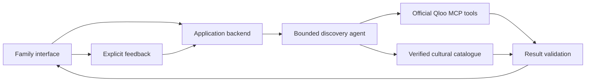

# Heritage Bridge — draft build plan

**Status:** implementation authorized October 4, 2026, in the requested new chat. Multiple collections from day one is confirmed. Use Google Gemini; the user will add Qloo and Gemini credentials to the repository-root `.env` when available. Begin with explicitly labeled fixtures and implement server-side integration without waiting for keys. Live validation remains pending. Tuesday Fix remains preserved. Earlier planning-stage wording below records the draft sequence and is superseded by this status.

## 1. Product promise

**Find a piece of your culture you'll love sharing with your family.**

### October 4 product update — curated collections first

The user authorized building the collection-led platform discussed in the planning chat. This update supersedes the mandatory favorites-first opening and related sequencing below. Preserve the user's chosen personal family scrapbook design direction and the existing working album, notes and feedback; extend the implementation rather than restart it.

The primary journey is **browse curated collections → open a collection → explore a work → watch/listen or save to the family album**. No favorites, account, personal note or questionnaire is required before browsing. Optional personalization becomes a contextual action inside a collection: **“Find my starting point.”** A visitor can supply familiar favorites, or explicitly choose a work they like as a Qloo seed for further exploration. Simply opening a work is not a positive preference signal.

Build these concrete surfaces:

1. **Explore:** an authored collection library with three usable launch collections and concise scope descriptions. Use the proposed Hindi, Tamil and Mexican source catalogues, but present specific editorial invitations rather than only broad language tabs. A title such as “A first Tamil film night” is an editorial proposition, not a claim that every entry is age-suitable.
2. **Collection detail:** clear introduction, who it may interest, editorial rationale, deliberate default order, verified work facts and destinations, and direct work/save actions. Use real curated content with source records. Missing enrichment stays absent or explicitly unknown.
3. **Optional personal starting point:** Qloo ranks eligible works from confirmed favorites; show what actually changed and evidence for the suggestion. Editorial order remains available and is not mislabeled as Qloo output.
4. **Explore a connection:** from an explicitly liked work, use Qloo to find an eligible music or film discovery, including a link into another curated collection where supported. Query/rank within a declared target domain and pool; do not compare raw scores between separate domains. This is a bounded next step, not an unrestricted blended feed.
5. **Family album:** reuse existing saved works, collection filters and local personal notes; saving directly from browsing must work as well as saving a personalized discovery. Do not imply multi-device family sharing while storage is browser-local.

Content model: maintain collections independently of discovery requests, with stable slugs, ordered work references, editorial introduction and rationale, provenance, version and review status. Work detail routes and collection links should survive a page refresh. Start with a versioned local editorial catalogue and validation tooling; a public curator CMS is not required for the first release. Distinguish verified editorial facts from synthetic fixture relationships. Neither LLM output nor an undocumented affinity is a curation source.

Qloo must remain central to the adaptive discovery path. During curation it may suggest cross-domain candidates for human review; record real returned evidence and permit only bounded caching allowed by the service. While keys are absent, build the adapters and clearly labeled example interactions without claiming that existing collections were Qloo-curated. The library remains browseable during API outages, with personalization explicitly unavailable rather than silently replaced.

**Next implementation slice:** complete Explore → collection detail → work → save, alongside optional personalization entry and existing album. Then connect the verified Qloo path when keys are available. Check desktop/mobile composition, keyboard navigation, direct-link reloads, saving without favorites, preserving existing notes, empty collections and unavailable personalization. Keep current sample/live labels honest. Do not delay the browsing experience for participant interviews; real usefulness testing remains a later evidence task.

The first useful outcome is one real film or musical discovery a family wants to try together. Qloo supplies the cultural-affinity evidence behind that choice. The application helps the family act on it and learn from its response.

Success is a complete loop: familiar favorites → relevant cultural entry points → a shared first encounter → explicit feedback → a better-informed next suggestion. We will not claim that discovery proves stronger identity, language proficiency or a predicted personal preference.

## 2. Proposed launch scope

**Confirmed user requirement: multiple collections from day one.** The first release must demonstrate switching between real, independently curated collections. The proposed collection names and sizes below remain planning defaults.

| Decision | Proposed first version | Reason |
|---|---|---|
| Cultural collections | Three proposed starter collections: Hindi cinema and music; Tamil cinema and music; Mexican cinema and music | Demonstrates regional and international breadth. These are bounded editorial collections, not definitions of entire cultures. Final names depend on verified source and Qloo coverage. |
| Audience | Parent-led discovery with teenagers and families | Lets both generations contribute preferences; exact age suitability remains a family decision. |
| Interface | English, responsive web application | Accessible public judging experience and a manageable first release. |
| Starting signals | Three favorites across films, music artists or books | Enough context for cross-domain discovery without a long quiz. |
| Candidate catalogue | Initially 12 films and 8 artists per collection: approximately 60 entries total, each artist with a verified listening entry | Keeps three collections feasible to audit while supporting two output domains in each. Artist affinity is not a track-level prediction. |
| Result | Three choices, initially two films and one music discovery when valid results exist | A deliberate editorial arrangement rather than an incomparable all-domain score. Return fewer when evidence is insufficient. |
| Accounts | No account required for the first discovery | Judges and families can reach the useful result immediately. |
| Saved collection | Optional browser-local storage, with an obvious clear/reset action | Continuity without creating child accounts or a shared family backend prematurely. |

The first version includes a collection picker, entity confirmation, results, factual detail, official watch/listen links, saved choices, feedback and re-querying. A family can switch collections without re-entering favorites, then explicitly request fresh recommendations. Every launch collection must work end to end; a selector backed by only one working catalogue is incomplete.

Each collection has a stable ID, title, precise scope, curator rationale, source notes, catalogue version and coverage status. Items can belong to more than one collection with an explicit rationale. Language, geography and cultural membership are separate metadata fields; none is inferred from a person's name or identity. Initial discovery targets one selected collection at a time. Multi-collection mixing is later work because it needs an explicit allocation policy, not raw affinity-score comparisons.

## 3. The experience

### Screen A — two worlds

Opening copy: **“What do they love? What would you love to share?”**

One side holds three selected favorite covers or artist names. The other offers the three launch collections with short scope descriptions and an optional parent note: “Why this matters to me.” Selecting a collection is a voluntary choice about what to explore, not an ethnicity question. The note is written by the parent; the app never invents a family memory.

Search identifies actual works/artists and asks the user to confirm ambiguous matches. People can select a clearly labeled example to explore immediately. The main action is **“Find a first connection.”** No questionnaire before the first useful step.

### Screen B — three invitations

Three substantial cards display the discovered works, a concise reason to consider each, format, language, duration where verified, and relevant content information. The primary action is **“Try this together.”**

Separate two kinds of explanation:

- **Taste evidence:** what Qloo actually returned or which confirmed input set informed the query.
- **About the work:** sourced facts about themes, language or format.

A small expandable **“Why this appeared”** area exposes provenance without turning the main experience into an API dashboard. Specific favorite-to-result attribution appears only when returned and supported. No compatibility percentages or fabricated cultural links.

### Screen C — make it easy to begin

Show one official trailer, first listening link or viewing destination. Distinguish a promotional preview from the full work. Display region/availability limits where known; do not assert subscription access from an unverified link.

Allow saving a choice and the parent's own note. Playback remains under user control. Use permitted embeds only; link out when rights or embedding conditions are unclear.

### Screen D — what happened?

Two short independent feedback inputs:

1. Interest: **“Want more like this” / “Not for us” / “Haven't tried it.”**
2. Following along: **“Comfortable” / “Needed help” / “Too difficult.”**

Only an explicit like becomes a new positive taste signal. A dislike excludes the particular item; it does not automatically blacklist an entire genre or culture. Difficulty changes the application's entry-point constraints using verified metadata, while keeping confirmed interest. If suitable alternatives cannot be found, say so.

### The first ten seconds

The visitor understands the purpose, selects or edits favorites and sees the discovery begin. On a completed query, the same familiar favorites lead visibly to actual cultural works. Ten seconds is our comprehension target, not an invented API-latency guarantee. Loading states report real progress; no staged successful results.

## 4. Visual direction

An editorial family album: warm paper, dark ink, a restrained indigo accent, generous space and expressive typography. Use licensed or permitted artwork; a well-designed text card is the fallback. On desktop, place the two starting collections beside each other with discoveries between/below. On mobile, preserve the same reading order vertically.

One characteristic interaction: selecting a favorite gently highlights any supported relationship in the result evidence. Where attribution is absent, do not draw a specific causal connection. Respect reduced-motion settings.

The design must feel authored: strong hierarchy, thoughtful empty states, concise copy, keyboard-friendly search, visible focus, adequate contrast and useful loading/error states. Avoid a generic SaaS dashboard, decorative graph, excessive cards, chat as the main interface, or an oversized marketing page before the product.

**Visual checkpoint before broad implementation:** render one complete desktop and mobile discovery screen with clearly labeled fixture data. Review its composition at actual sizes. Then build the live flow using that approved direction; do not spread an unreviewed design across every screen.

## 5. Architecture and agent behavior

Proposed stack: React + TypeScript + Vite frontend; a Node + TypeScript backend; the official Qloo harness exposed through its MCP server; one LLM with tool-calling support behind a provider adapter. Use a supported Node runtime at least 22.19.0 for the current kit, verify package compatibility at setup and commit the lockfile. No vector database is needed for the initial bounded catalogue.

The agent decides whether an input needs clarification, which supported cultural queries to make, and how to respond to empty or partial results. Deterministic code validates eligible items and provenance. The LLM can explain grounded results; it cannot invent Qloo rankings, entities, ratings or availability.

| Stage | Responsibility | Guardrail |
|---|---|---|
| Resolve | Qloo identity tools plus user confirmation | Discover actual schemas; do not invent entity IDs. |
| Build eligible pool | Selected collection, local verified catalogue and explicit family constraints | Scope every request to eligible collection members; unknown required facts remain unknown. |
| Retrieve/rank | Qloo, separately by supported output type | Confirm bounded ranking with real responses before depending on it. |
| Assemble choices | Stable editorial slots and deduplication | No raw-score comparison across domains or unrelated queries. |
| Explain | Qloo evidence plus sourced work facts | Keep model interpretation distinguishable from returned evidence. |
| Refine | Explicit feedback followed by a fresh bounded request | No claim of guaranteed progress “deeper” into a culture. |

Configure a finite tool-call budget, request timeout, bounded retries and rate limits. Propagate `needs_input`, `empty`, `partial`, `degraded` and `error` into useful product states. Validate actual tool outputs, not documentation examples alone. Cache only necessary permitted results, with timestamps, collection ID and query/catalogue versions. Switching collections cancels or ignores stale requests; results and feedback history retain their collection context.

Three explicit development modes:

- **Live:** real Qloo evidence and a working agent.
- **Fixture preview:** design/test data, visibly labeled; cannot count as sponsor integration.
- **Unavailable:** live service failed or lacks credentials; explain the issue and preserve inputs. No silent LLM replacement presented as Qloo output.

## 6. Data and resources

Each catalogue record needs: application ID, resolved Qloo ID/type, title/artist, original-language evidence, collection rationale, content/rating sources where applicable, checked date, official destination, artwork permission/source and any availability limitations. Artist records link to a specific reviewed listening entry point; an artist's nationality does not establish the language or suitability of every song.

Store only what the app needs. The backend needs no child name, birth date, school, identity or viewing-account history. Send confirmed cultural entities, not the parent's private memory note, as Qloo signals. Keep the optional note local. Recording child participation or recruiting families is a separate study step, not implied by building the interface.

| Resource | Current position | When needed |
|---|---|---|
| Qloo event access | Previously missing; no new key status confirmed | Real entity coverage and ranking tests |
| Tool-capable LLM API | User reports access; provider/API details unconfirmed | Live agent integration |
| Runtime | Existing prototype records Node 22.14; recheck installed state | Official harness requires a newer compatible runtime |
| Public media metadata and links | To curate and verify | Before results are usable |
| Hosting | Not selected | Public submission; choose a VM/container compatible with the MCP process |
| Family feedback | Not collected | Usefulness validation, beyond engineering correctness |

The competition supplies a Qloo-access application, kit and support links. No LLM or hosting credits are confirmed. Keep credentials out of chat, source control and browser bundles. Establish a spend limit before billable integration tests; do not guess provider entitlement from a chat subscription.

## 7. Build sequence and exit conditions

| Milestone | Work | Done when |
|---|---|---|
| 0. Setup and evidence spike | Create isolated app folder, verify runtime, inspect real Qloo schemas, curate a sample from all three collections | Document resolution/ranking and source coverage separately per collection and domain; design work can proceed with labeled fixtures while access is pending. |
| 1. Design the first encounter | Implement the opening and three-choice composition, desktop/mobile | Purpose is legible immediately; one complete interaction looks intentional and works with keyboard/touch. |
| 2. Live vertical slice | Favorites → selected collection → Qloo → validated candidates → grounded cards → official destination | All three collections produce real traceable results; switching preserves favorites and cannot display stale results from the previous collection. |
| 3. Repeat-use loop | Saved choices, separate feedback, exclusion and re-query | Feedback predictably changes the next request and keeps family constraints intact. |
| 4. Reliability and evidence | Ambiguity, missing metadata, API failure, quotas, empty pools; comparison harness | Core invariants pass, failures are intelligible, and a fair Qloo-versus-baseline comparison is reproducible. |
| 5. Submission readiness | Clean setup instructions, license, public-app configuration, screenshots and concise description | Another person can run it; deployment is reviewed and authorized separately; published claims match demonstrated behavior. |

Working estimate: roughly two to three focused development weeks, including the additional curation for three collections, with an initial coverage/design checkpoint in the first two days. API issuance and participant availability are external dependencies, so this is not a delivery promise. The official deadline is **October 31, 2026 at 9:15 a.m. IST**; aim to leave the final week for evidence, stability and presentation. Reduce catalogue size or ancillary features before silently dropping the confirmed multi-collection requirement.

## 8. Acceptance and proof

Engineering checks must cover actual risks:

- Ambiguous entities require confirmation; unsupported favorites have a usable correction path.
- Displayed results come from returned Qloo entities and the eligible catalogue.
- Every launch collection works independently; collection switching preserves inputs, isolates cached results and handles stale responses correctly.
- Dislikes are excluded, new likes are explicit, and difficulty is not misread as dislike.
- Attribution, content information and availability are never invented.
- Missing/partial Qloo output does not silently become an apparently successful generic recommendation.
- Credentials remain server-side; anonymous public use has bounded request costs.
- Desktop/mobile, keyboard operation, reduced motion, loading, empty and error states work end to end.

For the sponsor-removal comparison, use identical favorites, eligible pool, work facts, constraints and presentation. Compare Qloo with an equally informed LLM with web access, ordinary genre/popularity choices and the parent's own selection. Record actual sources, latency and effort. Shuffling favorites is a diagnostic only.

Suggested early coverage gate: at least 16 of each collection's frozen 20 candidate entities resolve correctly, including at least 9 films and 6 artists. Assess each collection independently; aggregate coverage cannot hide a failing collection. This checks identity coverage only, not recommendation quality. Ranking must also return usable eligible choices for documented test profiles. Lower coverage triggers an explicit catalogue or collection-selection review, not invented matches or a silent retreat to a single collection.

A small study with eight consenting families can screen for usefulness; six preferring Qloo is a proposed continuation threshold, not statistical proof. Parent preference supports parent usefulness. Actual voluntary interest and a shared first encounter are needed before claiming benefit to the child. Study recruitment and collection are not performed as part of this draft.

## 9. Growth after the core works

Expand beyond the three launch collections, deepen family-authored memories and introduce curator-managed collections. Later consider trusted community contributors and group discovery sessions. Each addition must improve the same family-discovery loop; public profiles, social feeds, payments and marketplace infrastructure are outside the first version.

## 10. New-chat handoff

Use the same saved repository so the new chat can read uncommitted research. Put the new implementation in `apps/heritage-bridge/`, with its own package and setup instructions. Preserve the root Tuesday Fix app and previous research; do not reset or overwrite them.

Read HERITAGE_BRIDGE_NEW_CHAT_HANDOFF.md for the ready-to-use build brief. The current turn stops at the draft plan. Open the new build chat as the next workflow step after this plan discussion, carrying forward any corrections. No new chat or app has been created yet.

## Sources

- [Official event and submission requirements](https://qloo.devpost.com/)
- [Official rules and judging criteria](https://qloo.devpost.com/rules)
- [Qloo kit](https://github.com/qloo/qloo-hackathon-kit)
- [API access, shared quotas and bounded caching](https://github.com/qloo/qloo-hackathon-kit/blob/main/docs/API_ACCESS.md)
- [MCP tool chain and deployment route](https://github.com/qloo/qloo-hackathon-kit/blob/main/starter/mcp-client/README.md)
- [Submission evidence guide](https://github.com/qloo/qloo-hackathon-kit/blob/main/docs/SUBMISSION.md)
- Local QLOO_CORE_SHORTLIST.md for need evidence, competitor analysis and unresolved claims.
